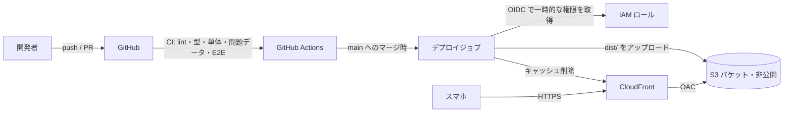
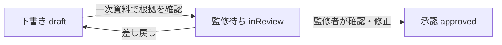

# 開発計画書 — 8人制 審判トレーニング

- 版: v1.2（2026-10-17）
- 状態: **M1（基盤の移行）完了・GitHub Pages で試験公開中** → 次は M2（出題の仕組みと作成ツール）
- 公開URL: https://daisuke-awaji.github.io/soccer8-referee-quiz/
- 前提: 試作版 v0.1（`prototype/`）の成果を引き継ぎ、問題数を増やせる構成に作り直してクラウドで公開する

---

## 1. 目的

8人制サッカー（主にU-12）の審判を担当する **保護者審判** と **4級審判員** が、スマホで「プレーを見て、判定の瞬間で止めて、答える」練習を続けられるようにする。

試作版で、次の2点は手応えを確認できた。

- 問いを先に読み → 再生 → 判定の瞬間で停止 → 回答 → 解説リプレイ、という流れ
- 2D（SVGアニメーション）と3D（視点によって見え方が変わる教材）の組み合わせ

今回の計画で解決する課題は次の3つ。

| 課題 | 試作版の状態 | この計画での方針 |
|---|---|---|
| 問題数が少ない | 10問 | **60問**（第1弾）を目標に、問題を足しやすい仕組みを先に作る |
| 1ファイルHTML | 問題データがJSに直書き。増やすと保守できない | Vite + TypeScript の通常構成。問題は **1問1ファイル** のデータにする |
| 公開方法がない | ファイルを手渡し | 静的サイトとしてビルドし、**AWS（S3 + CloudFront）** に GitHub Actions からデプロイ。AWSリソースは利用者（オーナー）が自分で作成する |

## 2. 対象ユーザーと利用シーン

| ユーザー | 想定 | 必要なこと |
|---|---|---|
| 保護者審判 | 当番で副審・主審を務める。競技規則はほぼ未経験 | 用語の説明、何度でも見直せる、短時間（1回5〜10分） |
| 4級審判員 | 講習会を受けた、またはこれから受ける | 11人制と共通の規則（ファウル・懲戒・オフサイドの細部）まで、試合に近い条件で判断 |
| 監修者（審判インストラクター等） | 問題の正しさを確認する | 全問をまとめて見られる、問題単位で直接開ける、確認状況が分かる |

**レベルは分けない**（2026-10-17 に決定）。保護者審判も4級審判員も同じ問題を解く。用語の説明・何度でも見直せる・スロー再生・ヒントは全員が使える。

利用シーンは、移動中や試合会場の待ち時間でのスマホ片手操作が中心。**屋外・電波が弱い場所** でも動くことを重視する。

## 3. スコープ

### やること（第1弾）

1. 試作版の機能を新しい構成に移植する（2D・3D・配置問題・解説リプレイ）
2. 問題を1問1ファイルで管理し、ビルド時にスキーマで検査する
3. 出題の仕組み（問題バンクからの出題、分野別練習、まちがえた問題の復習）
4. 問題作成を速くする道具（シーン編集ツール、問題一覧ページ、監修用の確認シート）
5. 問題の拡充（60問）
6. テスト（単体・問題データ・E2E・見た目の比較・アクセシビリティ）と CI
7. AWS へのデプロイ用ワークフロー（AWSリソースの作成はオーナーが行う）
8. オフライン対応（PWA）

### やらないこと（第1弾）

- ログイン・アカウント・サーバー側への成績保存（成績は端末内のみ）
- アクセス解析・個人を特定できる情報の収集（子どもの試合を扱うため、まずは収集しない）
- 英語など多言語対応
- 11人制専用の問題（4級向けに「11人制と共通の規則」は扱うが、場面は8人制のピッチで描く）

## 4. 技術構成

### 4.1 構成の方針

| 項目 | 採用 | 理由 |
|---|---|---|
| ビルド | **Vite** | 静的サイトとして出力でき、3D部分だけ別ファイルに分けて後から読み込める |
| 言語 | **TypeScript**（strict） | 問題データの型とアプリのコードを一致させる |
| UI | **React** | 画面数・状態が増えるため。2Dピッチは React から SVG を描画、3D は three.js を直接使う |
| 問題データの検査 | **Zod**（JSON Schema も生成） | ビルド時と単体テストで同じ定義を使う |
| 問題データの形式 | **YAML（1問1ファイル）** | 人が読み書きしやすく、監修者とのやりとりでも差分が見やすい |
| 3D | **three.js**（npm で同梱、CDN は使わない） | オフラインでも動く。3D問題を開いたときだけ読み込む |
| オフライン | **vite-plugin-pwa**（Service Worker） | 試合会場など電波の弱い場所で使えるようにする |
| 単体テスト | **Vitest** | 採点・出題・補間計算・問題データの検査 |
| E2E・見た目 | **Playwright** | スマホ縦・横の画面で全問を通しで操作し、画面を撮って比較する |
| アクセシビリティ | **@axe-core/playwright** | 主要画面で自動チェック |
| 品質 | ESLint + Prettier、型チェック | CI で必須 |

> 技術選定は試作版の構成（素のJS・SVG・three.js）を土台にしている。React を使うかどうかは §12 の「決めていただきたいこと」に含める。

### 4.2 ディレクトリ構成（予定）

```
.
├── content/                 # 問題データ（コードと分けて管理）
│   ├── questions/
│   │   ├── A-01.yaml
│   │   └── ...
│   ├── glossary.yaml        # 用語集（タップで説明）
│   └── sources.yaml         # 出典（ID・資料名・URL・版）
├── src/
│   ├── content/             # Zod スキーマ・読み込み・検査
│   ├── engine/              # 出題・採点・復習の仕組み（UIに依存しない）
│   ├── pitch2d/             # 2Dピッチ描画・アニメーション・配置問題
│   ├── scene3d/             # 3Dシーン（後から読み込む別ファイル）
│   ├── screens/             # ホーム・問題・結果・分野別・設定
│   ├── components/
│   └── storage/             # 端末内の保存（バージョン付き）
├── tools/
│   ├── scene-editor/        # シーン編集ツール（開発時のみ）
│   └── review-sheet/        # 監修用の確認シートを生成
├── tests/
│   ├── unit/
│   └── e2e/
├── prototype/               # 試作版 v0.1（参照用。移植が終わったら削除を検討）
├── docs/
└── .github/workflows/
```

### 4.3 問題データの形式

試作版の `schema/question.schema.json` と `app/js/data.js` の構造を引き継ぎ、次の項目を加える。

| 項目 | 内容 |
|---|---|
| `id` | `A-01` 形式。分野の英字1文字＋2〜3桁 |
| `format` | `animation` / `placement` / `choice` / `trueFalse`（新規）/ `signal`（新規）/ `scene3d` |
| `review` | 監修の状態 `draft` → `inReview` → `approved`、監修者・日付・メモ |
| `ruleBase` | 準拠する規則の版（`2026/27` など）。改正点には `new2026` バッジ |
| `sources` | `sources.yaml` の出典ID ＋ 条文・ページ。**全問で必須** |
| `scene` | 2Dの登場人物・キーフレーム・重ね表示（座標は m 単位、試作版と同じ） |

ビルド時の検査（`npm run content:check`）で次を確認し、1つでも違反があれば CI を失敗させる。

- スキーマに合っている
- 正解の選択肢が存在する。配置問題は正解の範囲（許容範囲）が設定されている
- キーフレームの時刻が増えていく順になっている。登場人物のIDがすべて定義されている
- 出典IDが `sources.yaml` に存在する
- 用語集にない用語を本文の用語マークで参照していない
- `approved` 以外の問題には、画面で「監修前」と表示する設定になっている

### 4.4 公開構成（AWS）



> **2026-10-17 更新**: まずは **GitHub Pages**（`.github/workflows/pages.yml`）で公開する。リポジトリは公開（public）。ビルドは相対パス（`base: './'`）で出力するので、下の AWS 構成にも同じ成果物をそのまま置ける。

- **AWS リソース（S3・CloudFront・IAM ロール・証明書・ドメイン）はオーナーが作成する。** こちらで用意するのは、ビルド成果物と GitHub Actions のデプロイワークフロー、必要な設定値の一覧（バケット名・ディストリビューションID・ロールARN）。
- キャッシュ方針: ハッシュ付きのファイルは長期キャッシュ（immutable）、`index.html` と Service Worker はキャッシュしない。
- 画面の切り替えは URL のハッシュ（`#/quiz/A-01`）で行い、CloudFront 側の書き換え設定を不要にする。
- 環境は **staging（PRの確認・実機テスト）** と **production** の2つを想定する。

## 5. 出題の仕組み（ステージ）

- 問題を約10問ずつの **ステージ** に分ける（`content/stages.yaml`）。ステージにはアイコンとテーマがある。
- ホームにステージが並び、**好きなものを選んで** 始める。順番にクリアする必要はない。ライフ（回数制限）はない。
- ステージの最後に結果を出す。「間違えた問題をもう一度」「もう一度」「ホームへ」を選べる。
- ホームのステージには、前回の正解数（例：8/10）を出す。途中でやめたステージは「続きから」で再開できる。
- 成績・進み具合は端末内（localStorage）に保存する。保存形式にはバージョン番号を付ける（v3 でステージ制にした。以前の途中の出題は引き継がない）。

| ステージ | 問題 |
|---|---|
| 🥅 フィールドと用具 | A-01, A-02, A-06〜A-10, F-01, F-05, B-06 |
| 🪙 試合開始の手順 | K-01〜K-10 |
| ⏱️ 時間・人数・交代 | J-03〜J-06, B-01, B-03〜B-05, B-09, F-04 |
| 🧤 GKと手・懲戒 | G-03, G-13〜G-19, G-02, G-11 |
| 🚩 再開・オフサイド・位置 | C-01, C-02, D-01, D-02, E-01, H-01 |

## 6. 問題の拡充計画

詳細は [question-backlog.md](./question-backlog.md)。

### 6.1 目標数

| | 問題数 |
|---|---|
| 試作版 v0.1 | 10 |
| **第1弾（M3）** | **約60** |
| 第2弾（M6） | 約80 |

- 3D問題は作る手間が大きいため、第1弾で **3問**（H-01 ＋ 2問）にとどめる。
- 候補は96問。そのうち第1弾の対象（P1）は **67問**。監修で外れる問題が出ることを見込んで、目標より少し多めにしている。

### 6.2 分野

| 記号 | 分野 | 主な根拠 |
|---|---|---|
| A | フィールド・ボール・用具 | 8人制 第1・2・4条 |
| B | 競技者・交代 | 8人制 第3条 |
| C | プレーの開始・再開 | 第8・13〜17条（8人制の修正を含む） |
| D | オフサイド | 第11条 |
| E | ポジショニング | 審判法（3人制・1人制） |
| F | 審判団の役割 | 第5・6条、8人制「補助審判の役割」 |
| G | ファウル・不正行為・懲戒 | 第12条、8人制 グリーンカード |
| H | 3Dの接触・ハンドの判定 | 第12条 |
| I | シグナル（合図） | 審判員のシグナル・副審の旗 |
| J | 試合時間・勝敗の決定・インとアウト | 第7・9・10条（8人制の修正を含む） |

### 6.3 作り方の工夫（作る手間を下げる）

問題の種類ごとに作る手間が大きく違うため、手間の小さい種類で数を確保し、アニメーションと3Dは「見ないと判断できない場面」に絞る。

| 種類 | 1問あたりの手間（目安） | 第1弾での数 | 使いどころ |
|---|---|---|---|
| ○×・選択式（図つき） | 小 | 17 | 数字・手続き・役割など、知識の確認 |
| シグナル | 小〜中 | 2 | 合図の意味を答える（主審・副審のポーズを図で表示） |
| 配置（ドラッグ） | 中 | 8 | 立ち位置・マークの位置 |
| 2Dアニメーション | 中〜大 | 33 | オフサイド・再開・ファウルなど、動きを見て判断する場面 |
| 3D | 大 | 3 | 見る位置によって判断が変わる場面 |

> 数は question-backlog.md の P1（63問）の内訳。アニメーションが半分を占めるため、シーン編集ツール（M2）を先に作ることが問題数を確保する鍵になる。

- **シーン編集ツール**（開発時のみ使うページ）で、ピッチ上の選手をドラッグしてキーフレームを記録し、YAML として書き出す。試作版では座標を手で書いていたため、ここが一番の時間短縮になる。
- 似た場面は「シーンの部品」（例: 攻撃の基本配置、スローインの配置）を使い回す。

### 6.4 正しさの担保（監修の流れ）



1. 問題を作るときは、**一次資料（JFA の競技規則・8人制競技規則）の条文とページを必ず記録** する。根拠を確認できない問題は作らない。
2. 審判法（ポジショニング）や懲戒の程度など、規則の文章だけで正解が決まらない問題は `needsReview` を付け、監修者に正解と許容範囲を決めてもらう。
3. `tools/review-sheet` で、監修者向けの確認シート（問題・正解・解説・出典・画面の画像）を問題ごとにまとめて出力する。
4. 競技規則の改正（毎年）に備え、各問題に準拠する版を記録する。改正時は該当する版の問題を一覧にして見直す。

## 7. マイルストーン

| # | 名前 | 内容 | 完了の条件 |
|---|---|---|---|
| **M0** | 計画 | リポジトリ作成、計画書・問題候補の一覧、試作版の保管 | この計画書が main にある（**今回**） |
| **M1** ✅ | 基盤の移行 | Vite + TS + React の構成、試作版10問をYAMLへ移行、2D・3D・配置問題の移植、Zod による検査、CI（lint・型・単体・問題データ検査・E2E） | 試作版と同じ10問を入門・4級で最後まで解ける。CI が通る。1ファイル版と見た目・動きが同等 |
| **M2** | 出題の仕組みと作成ツール | 問題バンク・4つのモード・習熟度表示、シーン編集ツール、問題一覧ページ、監修シート生成、PWA | 問題を1問追加するのに「YAMLを1つ足すだけ」で済む。オフラインで起動できる |
| **M2.5** ✅（実機確認は未） | 試験公開 | GitHub Pages へのデプロイ（main へのマージで自動） | 公開URLで実機（iPhone / Android）から使える |
| **M3** | 問題の拡充 第1弾 | 60問、3D を3問に | 目標数に達し、全問が `inReview` 以上。全問のE2Eと画面比較が通る |
| **M4** | 監修と実機テスト | 監修者の確認、保護者・4級審判員によるテスト、わかりにくいと言われた問題の改善 | 公開する問題が `approved`、またはその問題に「監修前」と表示されている |
| **M5** | 本番公開 | production へのデプロイ、公開手順書 | 本番URLで公開。障害時の切り戻し手順がある |
| **M6** | 問題の拡充 第2弾 | 80問、3Dの追加 | 目標数に達する |

各マイルストーンは GitHub の Milestone と Issue で管理する（Issue の分け方は §11）。

## 8. 品質とテスト

| 種類 | 内容 | 実行のタイミング |
|---|---|---|
| 問題データの検査 | §4.3 のすべての項目 | PRごと（必須） |
| 単体テスト | 採点（配置問題の許容範囲を含む）、出題の偏り、復習の仕組み、キーフレーム補間、保存形式の移行 | PRごと（必須） |
| E2E | **全問題を最後まで操作**（URL で問題を直接開く）。スマホ縦（375×667・390×844）と横（844×390） | PRごと（必須） |
| 画面の比較 | 各問題の「判定の瞬間」と「解説」の画面を撮って、前回と比べる | PRごと（差分があればレビュー） |
| アクセシビリティ | ホーム・問題・結果の各画面を axe でチェック。タップ領域は44px以上、文字は16px基準 | PRごと |
| 性能 | 最初に読み込むJS（3Dを除く）は gzip 後 150KB 以下を目標。3Dは別ファイルで後から読み込む | PRごと（記録のみ） |
| 実機 | iPhone（Safari）・Android（Chrome）。効果音・振動・3Dの速さ・オフライン | M2.5 以降、マイルストーンごと |

## 9. 保存とプライバシー

- 成績・設定・感想は端末内にのみ保存し、サーバーには送らない。
- 「結果と感想をコピー」（試作版の機能）は残し、テストの協力者から感想を集める方法にする。
- 解析ツールを入れる場合は、別途方針を決めてから（第1弾ではやらない）。

## 10. リスクと対策

| リスク | 影響 | 対策 |
|---|---|---|
| 問題の正しさ（誤った判定を教えてしまう） | 大 | 一次資料の条文を必須にする。規則の文章だけで決まらない問題は監修者が決めるまで「監修前」と表示 |
| 競技規則の改正・適用開始日の違い | 中 | 問題ごとに準拠する版を記録。改正点には 🆕 と「大会要項で適用版を確認」を表示 |
| 8人制競技規則に書かれていない運用（例: 交代の10秒ルール、負傷者の1分ルール） | 中 | 8人制での運用が確認できるまで出題しない、または `needsReview` |
| アニメーションを作る手間で問題数が伸びない | 大 | シーン編集ツールを M2 で先に作る。手間の小さい種類で数を確保 |
| 3Dが古いスマホで重い | 中 | 3Dは後から読み込み、描画の品質を端末に合わせて下げる。使えない端末ではとばせる |
| 監修者の時間が取れない | 中 | 確認シートで1問あたりの確認時間を短くする。優先度の高い問題から順に依頼 |

## 11. GitHub での進め方

- ブランチ: `main`（常に staging に出せる状態）＋ 作業ごとのブランチ → PR → CI が通ったらマージ
- Issue の単位:
  - **開発**: 1つの機能・1つの画面ごと（例: 「出題: おまかせ10問の選び方」）
  - **問題**: **1問 = 1 Issue**。本文に「場面・正解・根拠（条文）・監修が必要な点」を書き、完成したら PR と紐づける
- ラベル: `type:feature` / `type:content` / `type:bug` / `cat:A`〜`cat:J` / `needs-review` / `rule:2026-27`
- 完了の条件（受け入れ条件）は「〜のとき、〜すること」の形で Issue に書く

## 12. 決めていただきたいこと

**決定済み（2026-10-17）**: UI は React を使う／リポジトリは公開（public）／公開先はまず GitHub Pages。

**残り**:

3. **AWS へ移すときのインフラのコード化**（AWSリソースはオーナーが作成。CDK などのコードをこのリポジトリに置くか、置かないか）
4. **「監修前」の問題を本番で出すか**（推奨: 出すが「監修前」と表示する。承認済みだけを出す案もある）
5. **問題数の目標**（第1弾: 60問で良いか）
6. **監修者**（誰に、どの分野から確認を依頼するか）

## 12.1 M1 で実装したこと（2026-10-17）

- Vite + React 19 + TypeScript（strict）。試作版の 2D（SVG）・3D（three.js、別ファイルで後から読み込み）・配置問題・解説リプレイ・レベル別の体験を移植
- 問題データを `content/questions/*.yaml`（1問1ファイル）へ移行。Zod のスキーマと、ファイルをまたいだ検査（`npm run content:check`）。検査に失敗するとビルドも失敗する
- 配置問題の説明文（試作版では関数）を宣言的な書き方（`describe.kind`）に変更
- 端末内の保存形式を v2 にし、試作版 v0.1 の保存内容を引き継ぐ
- テスト: 単体 28件（採点・補間・保存形式・集計・問題データの検査と、壊れたデータの検出）、E2E（全問を入門・4級で自動で解く、ホーム→結果→解き直し、中断と再開、直接リンク、用語、アクセシビリティ）
- CI（`.github/workflows/ci.yml`）と GitHub Pages への公開（`.github/workflows/pages.yml`）
- 3D 問題（H-01）の読み込みは約 140KB（gzip）。最初に読み込む JS は約 96KB（gzip）

まだやっていないこと（M2 以降）: PWA（オフライン）、出題モード（おまかせ10問・分野別・まちがえた問題・模擬テスト）、シーン編集ツール、監修シートの生成、画面の比較テスト。

## 13. 参考資料（一次資料）

- JFA「8人制サッカー競技規則」 https://www.jfa.jp/documents/pdf/eight/rules.pdf
- JFA「2026/27年サッカー競技規則 変更の概要と詳細」 https://www.jfa.jp/documents/pdf/soccer/law_soccer_260528_01.pdf
- JFA「2026/27サッカー競技規則の適用開始日について」 https://www.jfa.jp/documents/pdf/soccer/law_soccer_260528_02.pdf
- JFA「サッカー競技規則」 https://www.jfa.jp/laws/soccer/
